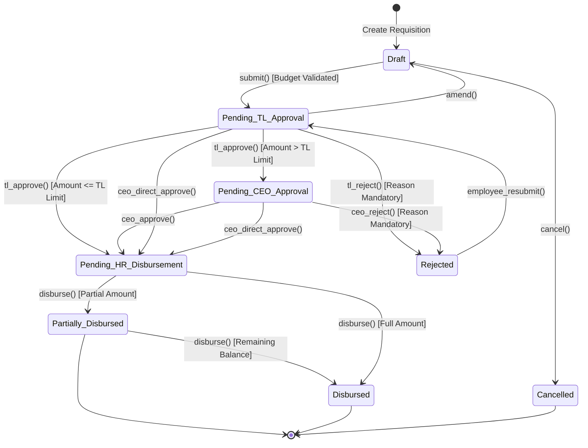
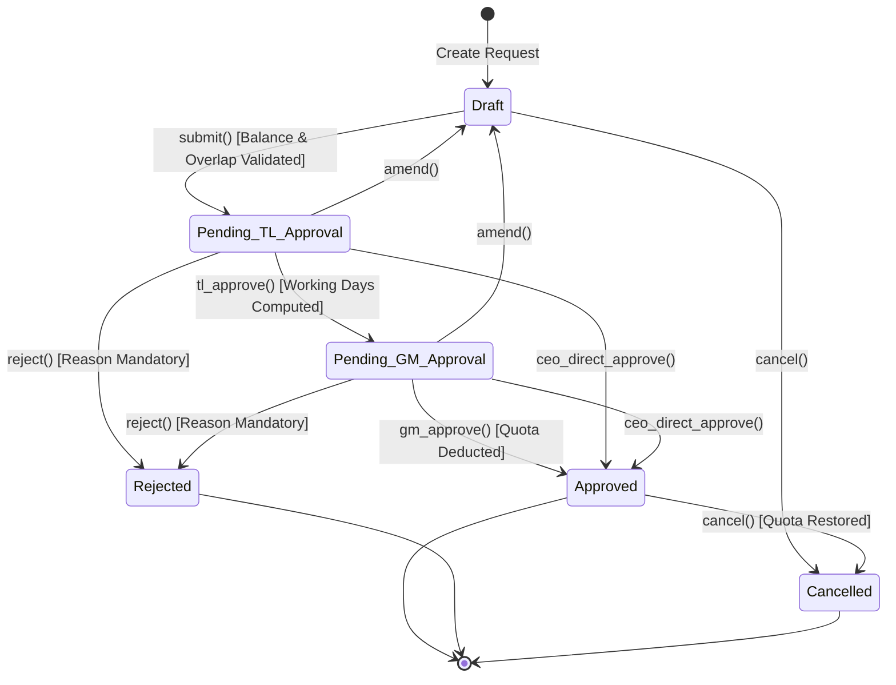

# Operations Management System (OMS) — Enterprise Multi-Tenant ERP & Petty Cash Engine

[](https://github.com/Zauwad/PettyCash)
[](https://www.djangoproject.com)
[](https://react.dev)
[](https://tailwindcss.com)
[](https://gsap.com)
[](#finite-state-machine-fsm-workflows)
[](#multi-tenant-architecture--brand-theming)

The **Operations Management System (OMS)** is a production-grade, multi-tenant enterprise ERP platform designed and deployed for three sister corporate organizations operating under the same parent group: **A Maze Venture**, **mYnt Connect**, and **Braincount**.

OMS modernizes financial requisitions, managerial approval chains, statutory leave administration, and temporary authority delegations into a unified, audit-logged web system governed by deterministic state machines.

---

## 📑 Architectural Table of Contents

1. [Executive Summary & Enterprise Impact](#executive-summary--enterprise-impact)
2. [Multi-Tenant Architecture & Brand Theming](#multi-tenant-architecture--brand-theming)
3. [Dual Finite State Machine (FSM) Workflows](#dual-finite-state-machine-fsm-workflows)
   - [Petty Cash Requisition FSM](#1-petty-cash-requisition-fsm)
   - [Statutory Leave Request FSM](#2-statutory-leave-request-fsm)
4. [Real-Time Financial Budget Engine & Mathematical Model](#real-time-financial-budget-engine--mathematical-model)
5. [Automated Bangladesh Statutory Calendar Engine](#automated-bangladesh-statutory-calendar-engine)
6. [Out-of-Office (OOO) Approval Delegation Engine](#out-of-office-ooo-approval-delegation-engine)
7. [Domain Model Directory (15 Enterprise Models)](#domain-model-directory-15-enterprise-models)
8. [REST API Architecture & Endpoints](#rest-api-architecture--endpoints)
9. [Frontend Design & Animation Choreography](#frontend-design--animation-choreography)
10. [Recruiter & Executive Demo Mode](#recruiter--executive-demo-mode)
11. [Production Container Deployment (Docker Compose)](#production-container-deployment-docker-compose)
12. [Local Development & Test Setup](#local-development--test-setup)

---

## 🏛️ Executive Summary & Enterprise Impact

Manual requisition forms, email approval threads, and untracked petty cash vouchers frequently lead to financial blind spots, budget overruns, and delayed operational spending. OMS replaces fragmented legacy processes with a modern digital platform:

* **Triple-Brand Tenant Isolation**: Supports **A Maze Venture**, **mYnt Connect**, and **Braincount** from a single deployment while completely isolating user pools, departmental cost centers, approval thresholds, and vouchers.
* **Deterministic Workflow Governance**: Powered by `django-fsm`, transitions must satisfy mathematical constraints (budget burn checks, approval authority limits) before execution, preventing skipped hierarchy levels.
* **Statutory Compliance**: Native calendar calculations automatically exclude Bangladesh official public holidays and Friday/Saturday weekends, safeguarding legal leave entitlements.
* **Enterprise Auditability**: Powered by `django-fsm-log` and `django-auditlog`, every transition, rejection comment, amendment, and disbursement is permanently logged with timestamps and user IDs.

---

## 🏢 Multi-Tenant Architecture & Brand Theming

OMS uses row-level tenant scoping linked to JWT bearer tokens:

```
                            [ Web / Mobile Client ]
                                       │
                                       ▼ JWT (tenant: slug / org_id)
                  ┌─────────────────────────────────────────┐
                  │      Django Tenant Context Resolver     │
                  └────────────────────┬────────────────────┘
                                       │
         ┌─────────────────────────────┼─────────────────────────────┐
         ▼                             ▼                             ▼
┌──────────────────┐          ┌──────────────────┐          ┌──────────────────┐
│  A Maze Venture  │          │   mYnt Connect   │          │    Braincount    │
│  Slug: amaze     │          │   Slug: mynt     │          │  Slug: braincount│
│  Theme: Emerald  │          │  Theme: Sunset   │          │  Theme: Cyberpunk│
│  Currency: ৳ BDT │          │  Currency: ৳ BDT │          │  Currency: ৳ BDT │
└──────────────────┘          └──────────────────┘          └──────────────────┘
```

### Dynamic Client-Side Theming Engine
When an authenticated employee signs in, the frontend dynamically maps the tenant's `theme_name` (`amaze`, `mynt`, or `braincount`) to DaisyUI CSS variables, modifying color palettes, logos, and typography instantly without requiring a page refresh.

---

## 🔄 Dual Finite State Machine (FSM) Workflows

Every transition in OMS is governed by strict deterministic state machines implemented via `django-fsm`.

### 1. Petty Cash Requisition FSM



### 2. Statutory Leave Request FSM



---

## 💰 Real-Time Financial Budget Engine & Mathematical Model

Before any petty cash requisition can be submitted, the system calculates available monthly department budget, taking in-flight commitments into account:

### 1. The Budget Commitment Equation

The available budget $\mathcal{B}_{\text{available}}$ for a department $\mathcal{D}$ in billing month $\mathcal{M}$ is defined as:

$$\mathcal{B}_{\text{available}} = \mathcal{B}_{\text{monthly}} - \mathcal{S}_{\text{spent}} - \mathcal{C}_{\text{inflight}}$$

Where:
* $\mathcal{B}_{\text{monthly}}$: Fixed monthly budget allocation for the department (`dept.monthly_budget`).
* $\mathcal{S}_{\text{spent}}$: Cumulative disbursed funds in the current calendar month (`dept.budget_spent_this_month`).
* $\mathcal{C}_{\text{inflight}}$: The total value of pending commitments across all unresolved requests:

$$\mathcal{C}_{\text{inflight}} = \sum_{r \in \mathcal{R}_{\text{inflight}}} \Big(\max(r.\text{amount\_approved}, r.\text{amount\_requested}) - r.\text{amount\_disbursed}\Big)$$

Where $\mathcal{R}_{\text{inflight}}$ is the set of all active requests in states:
$$\mathcal{R}_{\text{inflight}} = \{ r \mid r.\text{state} \in \{\text{'pending\_tl\_approval'}, \text{'pending\_ceo\_approval'}, \text{'pending\_hr\_disbursement'}, \text{'partially\_disbursed'}\} \setminus \{r_{\text{current}}\} \}$$

If $r_{\text{current}}.\text{amount\_requested} > \mathcal{B}_{\text{available}}$, the model throws a `ValidationError`, halting the transition.

### 2. Dual Threshold Routing Logic
When the Team Lead executes `tl_approve(amount, ...)`:
$$\text{Next State} = \begin{cases} \text{pending\_hr\_disbursement} & \text{if } \text{amount} \le \text{dept.tl\_approval\_limit} \\ \text{pending\_ceo\_approval} & \text{if } \text{amount} > \text{dept.tl\_approval\_limit} \end{cases}$$

---

## 🗓️ Automated Bangladesh Statutory Calendar Engine

Located in `oms_backend/leave/utils.py`, the calendar engine computes actual working days between $\text{start\_date}$ and $\text{end\_date}$ (inclusive):

```python
def calculate_working_days(organization, start_date, end_date):
    years = list(set([start_date.year, end_date.year]))
    bd_holidays = holidays.Bangladesh(years=years)
    
    company_holiday_dates = set(
        CompanyHoliday.objects.filter(
            organization=organization,
            holiday_date__range=(start_date, end_date)
        ).values_list('holiday_date', flat=True)
    )
    
    total_working_days = 0
    current_date = start_date
    while current_date <= end_date:
        # Bangladesh official weekend: Friday (4) and Saturday (5)
        is_weekend = current_date.weekday() in [4, 5]
        is_holiday = (current_date in bd_holidays) or (current_date in company_holiday_dates)
        
        if not is_weekend and not is_holiday:
            total_working_days += 1
        current_date += timedelta(days=1)
        
    return total_working_days
```

### Leave Carry-Forward Mathematics
At year rollover, annual leave carry-forward is bounded by the tenant's policy configuration:
$$\mathcal{Q}_{\text{carry}} = \min(\text{prev\_balance.available}, \text{org.policy\_config.max\_carry\_forward\_days})$$
$$\mathcal{Q}_{\text{total}} = \text{leave\_type.default\_days\_per\_year} + \mathcal{Q}_{\text{carry}}$$

---

## 🤝 Out-of-Office (OOO) Approval Delegation Engine

When managers or team leads travel or take leave, they can delegate their approval authority (`ApprovalDelegation` model in `core/models.py`):
* **Temporary Scope**: Bound by `start_date` and `end_date`.
* **Scoped Permissions**: Grants the surrogate user power to approve Petty Cash or Leave requests within the manager's designated departments.
* **Audit Trail Preservation**: Approvals enacted by a surrogate explicitly document both the acting user and the delegating principal in `AuditLog`.

---

## 📦 Domain Model Directory (15 Enterprise Models)

### Core Application (`oms_backend/core/`)
1. **`Organization`**: Multi-tenant container. Stores name, slug, theme name, logo URL, brand hex colors, and JSON `policy_config`.
2. **`Department`**: Cost centers within an organization. Manages `monthly_budget`, `budget_spent_this_month`, `budget_reset_day`, and `tl_approval_limit`.
3. **`AuditLog`**: Immutable event ledger tracking every entity mutation, actor ID, IP address, and state change.
4. **`ApprovalDelegation`**: Surrogate authorization record for absent managers.
5. **`Notification`**: Real-time user alert records for pending approvals, disbursements, and rejections.

### Accounts Application (`oms_backend/accounts/`)
6. **`UserProfile`**: Extends Django's `User` with `Organization`, `Department`, direct manager FK, phone, employee ID, and `UserRole`.
7. **`UserRole`** (`TextChoices`): `SUPERADMIN`, `CEO`, `GENERAL_MANAGER`, `TEAM_LEAD`, `EMPLOYEE`, `HR`, `FINANCE`.

### Petty Cash Application (`oms_backend/pettycash/`)
8. **`PettyCashRequest`**: The central requisition entity managed by `django-fsm`. Tracks requested, approved, and disbursed amounts, needed-by date, notes, and priority.
9. **`PettyCashLineItem`**: Itemized expenditures attached to a request (category, description, unit price, quantity).
10. **`Attachment`**: File and voucher uploads verifying purchases.
11. **`Disbursement`**: Financial payout record capturing payment mode (Cash, bKash, Nagad, Bank Transfer), reference code, and disbursing finance officer.
12. **`RequestPriority`** (`TextChoices`): `LOW`, `MEDIUM`, `HIGH`, `URGENT`.

### Leave Application (`oms_backend/leave/`)
13. **`LeaveType`**: Types of leave (Annual, Casual, Sick, Maternity) with negative balance and medical certificate upload flags.
14. **`LeaveBalance`**: Annual entitlement tracker per user (`total_allocated`, `used`, `pending`, `available`).
15. **`LeaveRequest`**: The FSM-governed leave requisition entity. Excludes weekends and statutory holidays in its duration math.
16. **`CompanyHoliday`**: Tenant-specific custom holiday calendar entries.

---

## ⚡ REST API Architecture & Endpoints

All endpoints are built with Django REST Framework and documented using **OpenAPI 3.0 / drf-spectacular**:

### Authentication & Profiles (`/api/`)
* `POST /api/auth/login/`: Issues JWT access and refresh tokens embedding tenant and role claims.
* `POST /api/auth/refresh/`: Refreshes expired access tokens.
* `POST /api/auth/logout/`: Blacklists active refresh token.
* `GET /api/auth/me/`: Returns authenticated user profile, permissions, active organization, and department metadata.
* `GET /api/users/`: Directory of employees within the user's active tenant.
* `GET /api/departments/`: Department lists and real-time budget burn metrics.

### Petty Cash Requisitions (`/api/petty-cash/`)
* `GET /api/petty-cash/`: Filterable list of requisitions (scoped by user role and department).
* `POST /api/petty-cash/`: Draft a new petty cash requisition.
* `POST /api/petty-cash/{id}/submit/`: Transition `draft` ➔ `pending_tl_approval`.
* `POST /api/petty-cash/{id}/tl_approve/`: TL approval with potential amount adjustment.
* `POST /api/petty-cash/{id}/ceo_approve/`: CEO approval for high-value requests.
* `POST /api/petty-cash/{id}/ceo_direct_approve/`: Superpower fast-track approval by CEO.
* `POST /api/petty-cash/{id}/disburse/`: Record full or partial financial disbursement.
* `POST /api/petty-cash/{id}/reject/`: Reject requisition with mandatory reason string.
* `POST /api/petty-cash/{id}/cancel/`: Requester cancellation of pending requests.
* `GET /api/attachments/{id}/download/`: Secure voucher attachment download stream.

### Leave Management (`/api/leave/`)
* `GET /api/leave/balances/`: User's current leave balance breakdown.
* `GET /api/leave/requests/`: Leave request history and pending approval queue.
* `POST /api/leave/requests/`: Create leave request.
* `POST /api/leave/requests/{id}/submit/`: Submit request for approval.
* `POST /api/leave/requests/{id}/tl_approve/`: Team Lead approval.
* `POST /api/leave/requests/{id}/gm_approve/`: General Manager final approval.
* `POST /api/leave/requests/{id}/reject/`: Rejection with reason.

### System Utilities
* `GET /api/schema/swagger-ui/`: Interactive Swagger UI explorer.
* `POST /api/cron/daily-tasks/`: Automated daily cleanup and delegation expiration cron trigger.

---

## 🎨 Frontend Design & Animation Choreography

The frontend (`oms_frontend`) is built with modern frontend engineering practices:

* **React 19 & Vite 6**: Lightning-fast Hot Module Replacement and optimized production bundle splitting.
* **Tailwind CSS v4 & DaisyUI v5**: Pure utility-first styling with comprehensive support for DaisyUI themes (`amaze`, `mynt`, `braincount`).
* **GSAP 3.15 & Framer Motion Choreography**:
  * Smooth accordion transitions on multi-step approval cards.
  * Number ticker animations on department budget burn meters.
  * Enter/exit animations on modal dialogs and notification trays.
* **TanStack Query v5**: In-memory caching, automatic background refetching, and optimistic UI updates for approval actions.
* **Form Validation**: Type-safe forms powered by **React Hook Form** and **Zod v4** schemas.

---

## 🎭 Recruiter & Executive Demo Mode

To allow prospective evaluators, recruiters, and executive stakeholders to test the complete multi-tier approval hierarchy without tedious account setups, OMS includes a **One-Click Persona Switcher** on the login page:

| Persona | Role | Available Actions in Demo Mode |
|:---|:---|:---|
| **Employee** | `EMPLOYEE` | Create and submit petty cash requisitions; submit leave requests; track personal balances. |
| **Team Lead** | `TEAM_LEAD` | Review direct reports' requisitions; approve items $\le$ ৳10,000; amend dates/amounts. |
| **CEO** | `CEO` | Review high-value escalations ($>$ ৳10,000); trigger direct superpower approvals; inspect company-wide analytics. |
| **Finance / HR** | `FINANCE` | Execute cash disbursements; manage voucher reconciliations; inspect departmental budget burn. |

---

## 🐳 Production Container Deployment (Docker Compose)

OMS provides a production-hardened multi-container Docker configuration:

```yaml
# docker-compose.prod.yml
version: '3.8'

services:
  backend:
    build:
      context: ./oms_backend
      dockerfile: Dockerfile
    container_name: oms_backend_prod
    restart: always
    env_file:
      - ./oms_backend/.env
    environment:
      - DEBUG=False
      - DATABASE_URL=sqlite:////app/db/db.sqlite3
    volumes:
      - django_static:/app/staticfiles
      - django_media:/app/media
      - sqlite_data:/app/db

  frontend:
    build:
      context: ./oms_frontend
      dockerfile: Dockerfile
    container_name: oms_frontend_prod
    restart: always
    ports:
      - "80:80"
    depends_on:
      - backend
    volumes:
      - django_static:/usr/share/nginx/html/static:ro
      - django_media:/usr/share/nginx/html/media:ro

volumes:
  sqlite_data:
  django_static:
  django_media:
```

### Launching in Production
```bash
docker compose -f docker-compose.prod.yml up --build -d
```
Nginx automatically serves the compiled React 19 single-page application and proxies all `/api/` traffic directly to Gunicorn WSGI workers, while serving uploaded media vouchers and static assets from shared Docker volumes.

---

## 💻 Local Development & Test Setup

### 1. Backend Setup
```bash
cd oms_backend

# Create virtual environment
python3 -m venv .venv
source .venv/bin/activate

# Install Python dependencies
pip install -r requirements.txt

# Run migrations
python manage.py migrate

# (Optional) Seed demo personas and tenant organizations
python manage.py loaddata ../local_data.json

# Launch development server
python manage.py runserver 0.0.0.0:8000
```
Swagger UI will be available at [http://localhost:8000/api/schema/swagger-ui/](http://localhost:8000/api/schema/swagger-ui/).

### 2. Frontend Setup
```bash
cd oms_frontend

# Install node dependencies
npm install

# Start Vite dev server
npm run dev
```
Open [http://localhost:5173](http://localhost:5173) in your browser.

---

## 👨‍💻 Engineering Leadership & Portfolio Highlight

* **Architecture**: Enterprise Multi-Tenant Operations & Financial ERP System
* **Author / Senior Engineer**: **Ridwanul Azim** ([@Zauwad](https://github.com/Zauwad))
* **Organization**: A Maze Venture / mYnt Connect / Braincount
